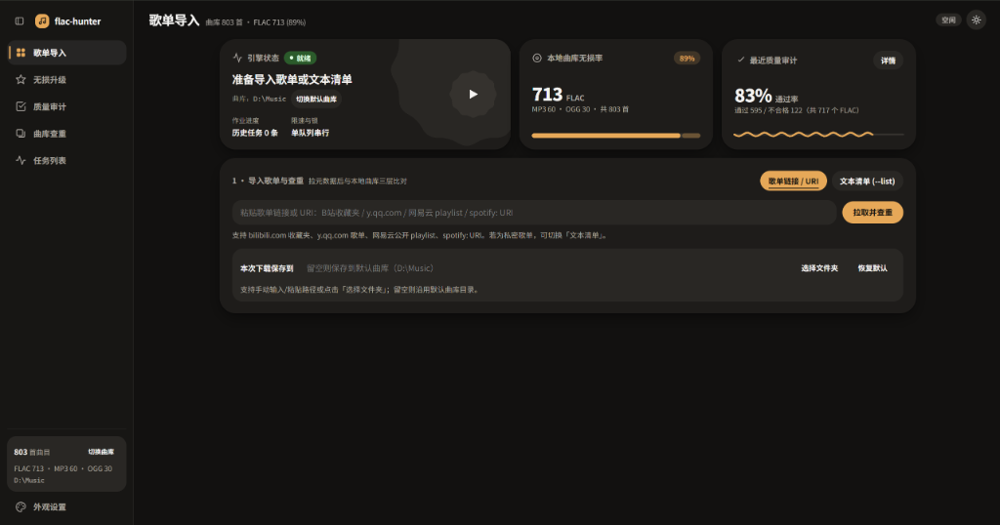
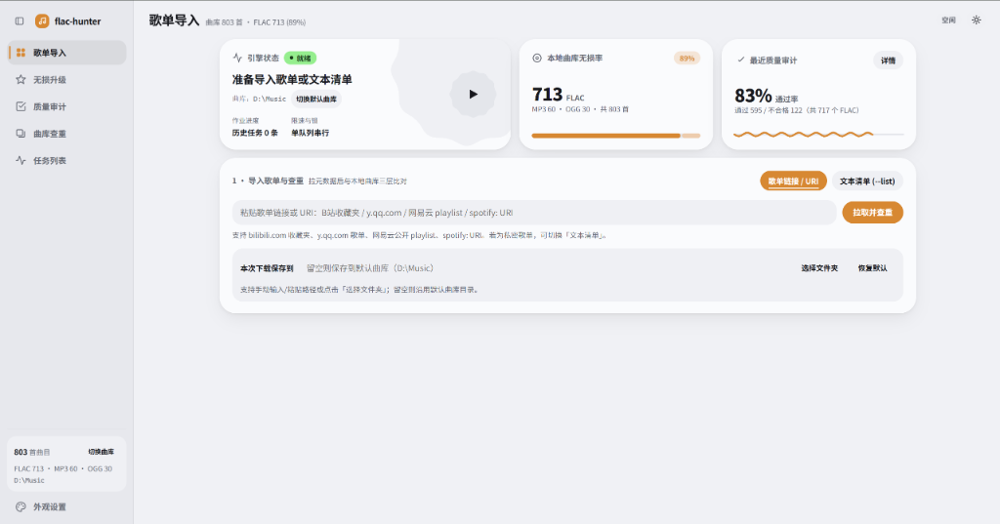
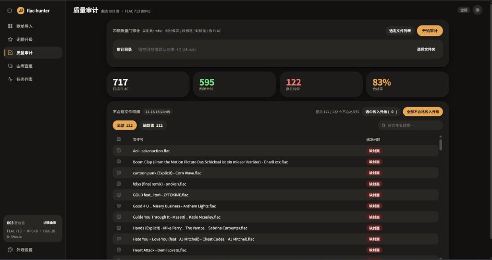

# flac-hunter

[中文](README.md) | [English](README_EN.md)

本地无损音乐下载与曲库管理工具（零 pip 依赖 Web GUI / CLI）：支持通过**歌单链接**或**文字搜索歌名**下载真 FLAC 无损音频，并提供旧库无损升级、四项质量审计与曲库查重清理，支持浅色 / 深色主题与中英文界面切换。

## 界面预览

| 歌单导入（深色模式） | 歌单导入（浅色模式） |
| :---: | :---: |
|  |  |

| 质量审计（四项质量门审计） |
| :---: |
|  |

## 一、开源与合规声明

本项目代码以 [MIT License](LICENSE) 开源发布，**仅供个人学习研究与本地曲库整理使用，严禁用于任何商业用途或公开代下载服务**。仓库中不包含、不存储也不分发任何受版权保护的音频内容；通过第三方公开接口检索或获取媒体内容产生的版权及平台服务条款合规责任，由使用者自行承担。

本地运行产物（`tasks/`、`.staging/`）与个人配置（`config.toml`）均已通过 `.gitignore` 排除，不会纳入版本库。

## 二、安装

- **Python ≥ 3.11**（本机 3.13.5），除可选依赖外全部使用标准库
  （`urllib`、`subprocess`、`tomllib`、`argparse`）。
- **外部工具**：`ffmpeg`、`ffprobe`、`yt-dlp` 需在 `PATH` 中。
- 可选依赖：`pip install musicdl`
  （长尾音源聚合，许可证为 **PolyForm Noncommercial 1.0.0**——仅允许非商业使用；
  缺席时相关音源自动优雅降级为空结果，不影响其余功能）。
- 配置：拷贝 `config.example.toml` 为 `config.toml` 并填写个人路径
  （`config.toml` 含个人信息，已被 `.gitignore` 排除）。

## 三、快速上手

**图形界面（推荐）**：双击 `启动 flac-hunter.bat`（或 `python gui.py`），
自动开浏览器 `http://127.0.0.1:8756`——歌单导入（含查重预览与勾选下载）、
实时进度、无损升级、质量审计四件套，零 pip 依赖。命令行方式：

```bash
# 0. 准备配置
cp config.example.toml config.toml   # 填 paths.music / paths.spotify_cli / 别名表

# 1. 拉歌单元数据 + 三层查重（艺人层 / 标题+时长 / 同题异唱）
python cli.py prepare --uri spotify:playlist:<id> --out tasks/tracks.json
python cli.py prepare --uri qq:1234567890
python cli.py prepare --uri netease:<公开歌单id>          # 网易云直连（匿名公开歌单）
python cli.py prepare --uri bili:fav:<收藏夹media_id>     # B站公开收藏夹
python cli.py prepare --uri "https://..."                 # 平台歌单 URL：网易云/QQ 自动路由直连，
                                                          # 其余平台走 musicdl（实验性：部分源已失效，
                                                          # 90s 截止兜底；私密歌单需 --list 或 cookie）
python cli.py prepare --list songs.txt                    # 文本清单兜底：每行 '歌名 - 歌手[ | 时长秒]'

# 2. 编排下载（auto 源序择优；staging 验证后原子落位曲库）
python cli.py download --tracks tasks/tracks.json --source auto

# 3. 旧文件无损升级（MP3/OGG -> 源 FLAC）
python cli.py upgrade --ext mp3

# 4. 质量审计（时长/标签/封面/真 FLAC 四项门）
python cli.py audit
```

配套命令：`dedupe`（查重聚类）、`lyrics-check`（歌词体检八类）、
`rename`（改名扫描，默认 dry-run，`--apply` 才执行）、
`durations-cache`（重建 `tasks/local_durations.json`）、
`fingerprint <a> <b>`（两文件 PCM 指纹对比）。
所有运行产物统一落在 `tasks/`；下载暂存为 `.staging/`。

## 四、源优先级方法论

下载按 `auto` 源序依次择优，顺序及其理由：

1. **GDStudio 无损**（netease / tencent / kuwo 三源聚合）——唯一的流式无损来源，
   `br>=999000` 才判无损命中，候选还需通过 tier A 档（时长差 ≤8s 且歌手/歌名相关）
   才允许写入。模块级强制间隔 ≥1.05s 限速。
2. **网易云官方 API**——字段规范、含专辑/歌手 hotSongs 深挖；匿名接口仅 128k，
   主要用于元数据搜索与兜底。
3. **musicdl**——聚合多站音乐平台源（酷狗/咪咕/QQ/酷我等），实测可返回 flac/320
   品质候选；平台官方库的错配风险天然低于开放视频站。候选过 tier A 档，
   同档内无损品质优先。
4. **B 站**——`yt-dlp` bestaudio 只有 AAC/Opus（拿不到真 FLAC），质量参差，
   必须走评分（阈值 55）+ 黑名单词 + 三段式搜索升级；用于音乐平台没收录的
   投稿/现场/翻唱版本。
5. **YouTube**——同样 `yt-dlp` 无损缺失，评分（阈值 50），作最后备选。

排序核心逻辑：**先无损后有损**——GDStudio/网易云/musicdl 音乐平台链路能拿到
真无损；B 站/YouTube 是开放视频平台（bestaudio 永远不是 FLAC）只作有损兜底，
再用评分与黑名单双重过滤控风险。

## 五、8 条硬规则

| # | 规则 | 说明 |
|---|------|------|
| 1 | 匹配方向 nt-in-nc 强制 | 带版本后缀的目标标题归一化后必须**完整包含于**候选标题；禁止反向 nc-in-nt（旧脚本双向包含是已知事故根源，必须修复） |
| 2 | 空标题保护 | 标题归一化后必须**双方非空**才参与比较（空串 `'' in x` 恒为 True 的陷阱） |
| 3 | PCM 指纹抽查 | 升级替换按比例抽样 `pcm_md5` 与替换前文件对比，只记录留证不强制相等 |
| 4 | shutil.move 跨盘 | 跨盘移动禁止 `os.replace`（WinError 17），必须 `shutil.move` |
| 5 | ffmpeg 真扩展名与 -f flac | 临时输出扩展名必须真实（`.flac`），remux 显式 `-f flac`，防止 ffmpeg 按扩展名猜封装 |
| 6 | UTF-8 subprocess | 所有 subprocess 传 `encoding="utf-8", errors="replace"`，入口模块头部重设 UTF-8 stdout/stderr |
| 7 | GD 限速 1.05s 与波浪 | GDStudio 请求模块级强制间隔 ≥1.05s，规避限流 |
| 8 | <100KB 拒收 | 下载流小于 100KB 视为报错页，拒收并抛错，绝不落盘 |

## 六、致谢与数据来源

- [musicdl](https://github.com/CharlesPikachu/musicdl)：可选长尾音源聚合依赖，
  许可证为 **PolyForm Noncommercial 1.0.0**（仅限非商业用途；如需用于商业场景，请勿安装或先移除该可选依赖）。
- 数据来源均为第三方公开接口：**GDStudio / 网易云音乐 / Bilibili / LRCLIB / QQ 音乐**。
  这些接口随时可能改版或失效，本项目不对其可用性做任何承诺，风险自担。
- 本项目只做检索与下载编排，不存储、不分发任何音频内容。

## 七、更新目标（GUI 路线图）

核心四件套已上线（`gui.py`）；以下按优先级排队的后续目标：

1. **作业取消**——终止运行中的子进程（现在只能等它跑完）。
2. **曲库浏览 / 搜索**——按歌手/标题/扩展名过滤曲库，直接对单个文件触发重下或升级。
3. **查重聚类视图**（`dedupe`）——可视化重复组并支持一键清理。
4. **歌词体检**（`lyrics-check`）——八类问题的图形化报告与一键删除错配 .lrc。
5. **改名工具**（`rename`）——dry-run 预览 + 勾选应用。
6. **指纹对比**（`fingerprint`）——选两个文件比对 PCM 指纹，鉴定双版本。
7. **私密歌单支持**——config 放 cookie（网易云/QQ 登录态）。
8. **打包 exe**——PyInstaller 单文件，免 Python 环境。
