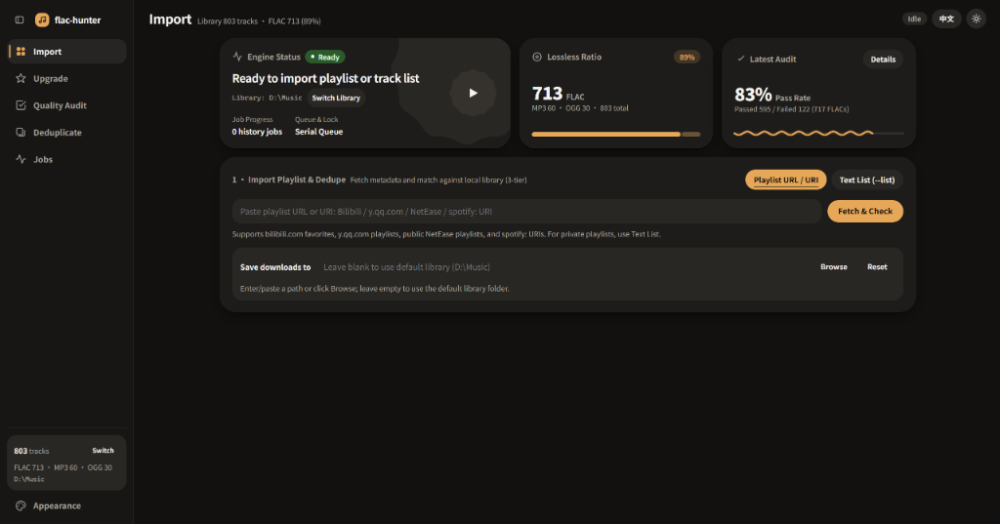
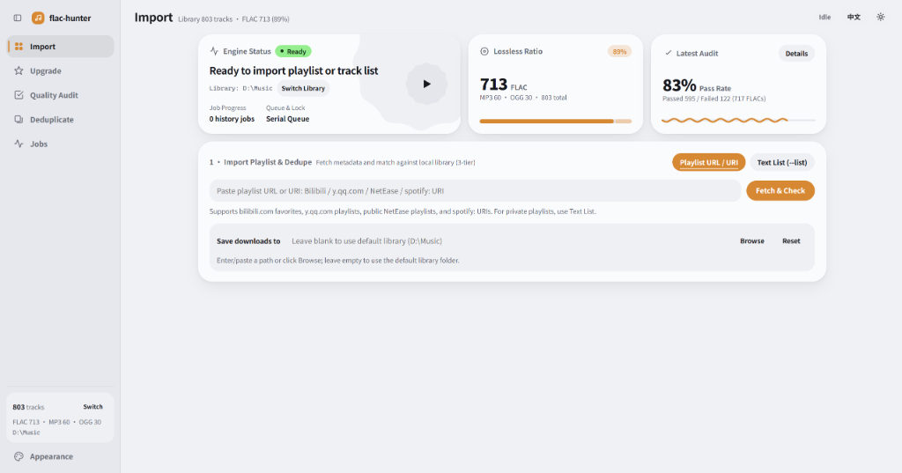
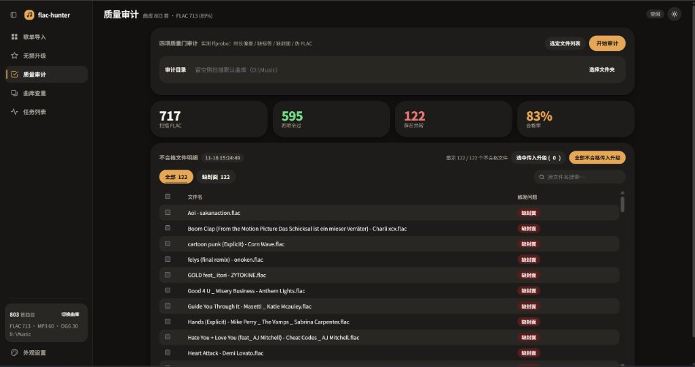

# flac-hunter

[中文](README.md) | [English](README_EN.md)

A local lossless music downloader and library manager (zero-pip-dependency Web GUI & CLI): download true FLAC lossless audio via **playlist URLs** or **text track lists**, with lossless library upgrade, 4-gate quality audit, and duplicate cleanup—supporting Light/Dark themes and Chinese/English UI switching.

## UI Preview

| Import & Dashboard (Dark Mode) | Import & Dashboard (Light Mode) |
| :---: | :---: |
|  |  |

| 4-Gate Quality Audit |
| :---: |
|  |

## 1. Open-Source & Compliance Notice

This project is released under the [MIT License](LICENSE) **for personal study, research, and local music library organization only. Any commercial use or public proxy-downloading service is strictly prohibited.** This repository does not contain, store, or distribute any copyrighted audio content. Users are solely responsible for complying with applicable copyright laws and third-party platform Terms of Service when querying or fetching media via public interfaces.

Local runtime artifacts (`tasks/`, `.staging/`) and personal configuration (`config.toml`) are excluded via `.gitignore` and will not be committed to the repository.

## 2. Installation

- **Python ≥ 3.11** (tested on 3.13.5), built entirely with the Python standard library (`urllib`, `subprocess`, `tomllib`, `argparse`) except for optional dependencies.
- **External tools**: `ffmpeg`, `ffprobe`, and `yt-dlp` must be available in `PATH`.
- **Optional dependency**: `pip install musicdl`
  (Long-tail music source aggregator, licensed under **PolyForm Noncommercial 1.0.0**—noncommercial use only; if omitted, related sources gracefully degrade to empty results without affecting other features).
- **Configuration**: Copy `config.example.toml` to `config.toml` and fill in your personal paths (`config.toml` contains personal info and is excluded by `.gitignore`).

## 3. Quick Start

**Web GUI (Recommended)**: Double-click `启动 flac-hunter.bat` (or run `python gui.py`) to automatically open `http://127.0.0.1:8756` in your browser (append `?lang=en` or click `EN` in the top-right corner for English UI). Includes playlist import (with 3-tier dedupe preview & selective download), real-time progress, lossless upgrade, quality audit, and library deduplication with zero pip dependencies.

CLI usage:

```bash
# 0. Prepare config
cp config.example.toml config.toml   # Fill paths.music / paths.spotify_cli / aliases

# 1. Fetch playlist metadata + 3-tier deduplication (artist / title+duration / same-title-other)
python cli.py prepare --uri spotify:playlist:<id> --out tasks/tracks.json
python cli.py prepare --uri qq:1234567890
python cli.py prepare --uri netease:<public_playlist_id>  # Direct NetEase public playlist
python cli.py prepare --uri bili:fav:<media_id>           # Direct Bilibili public favorites
python cli.py prepare --uri "https://..."                 # Playlist URL: NetEase/QQ route directly;
                                                          # others use musicdl (experimental, 90s timeout;
                                                          # private playlists require --list or cookie)
python cli.py prepare --list songs.txt                    # Text list fallback: 'Title - Artist[ | sec]' per line

# 2. Orchestrate download (auto source priority; verified in staging before atomic move)
python cli.py download --tracks tasks/tracks.json --source auto

# 3. Lossless upgrade for legacy files (MP3/OGG -> true FLAC)
python cli.py upgrade --ext mp3

# 4. Quality audit (4 gates: duration / tags / cover art / true FLAC)
python cli.py audit
```

Companion commands: `dedupe` (duplicate clustering), `lyrics-check` (8-category lyrics inspection), `rename` (filename scan, dry-run by default, `--apply` to execute), `durations-cache` (rebuild `tasks/local_durations.json`), and `fingerprint <a> <b>` (PCM fingerprint comparison between two files).
All runtime artifacts are stored in `tasks/`, and downloads are staged in `.staging/`.

## 4. Source Priority Methodology

Downloads in `auto` mode follow this priority order:

1. **GDStudio Lossless** (aggregates `netease` / `tencent` / `kuwo`) — the primary streaming lossless source. Lossless is only accepted when `br >= 999000`, and candidates must pass Tier A (duration diff ≤ 8s with matching artist/title) before writing. Module-level rate limit ≥ 1.05s.
2. **NetEase Official API** — clean metadata fields and album/artist `hotSongs` deep lookup; anonymous API only serves 128k, mainly used for metadata search and fallback.
3. **musicdl** — aggregates multiple music platforms (Kugou/Migu/QQ/Kuwo, etc.) and can return FLAC/320k candidates; official music platforms have much lower mismatch risk than open video sites. Candidates must pass Tier A, with lossless prioritized.
4. **Bilibili** — `yt-dlp` `bestaudio` only yields AAC/Opus (no true FLAC) with varying quality; must pass scoring (threshold 55) + blacklist filtering + 3-stage search upgrade. Used for covers, live versions, or uploads not on music platforms.
5. **YouTube** — similarly lacks lossless via `yt-dlp`, scored with threshold 50 as the final fallback.

Core principle: **Lossless before lossy** — music platform pipelines (GDStudio/NetEase/musicdl) can deliver true lossless, while open video platforms (Bilibili/YouTube) serve strictly as lossy fallbacks guarded by scoring and blacklists.

## 5. 8 Hard Rules

| # | Rule | Description |
|---|------|-------------|
| 1 | Enforced `nt-in-nc` direction | Normalized target title (with version suffix) must be **fully contained** in candidate title; reverse `nc-in-nt` is forbidden |
| 2 | Empty title guard | Both normalized titles must be **non-empty** before comparison (avoiding the `'' in x == True` trap) |
| 3 | PCM fingerprint sampling | Upgrade replacements sample `pcm_md5` against the old file for audit logging without forcing strict equality |
| 4 | Cross-drive `shutil.move` | Never use `os.replace` across drives (`WinError 17`); always use `shutil.move` |
| 5 | True extension & `-f flac` | Temporary output must use true extension (`.flac`), and remuxing explicitly passes `-f flac` |
| 6 | UTF-8 subprocesses | All subprocesses pass `encoding="utf-8", errors="replace"`, and entry modules enforce UTF-8 stdout/stderr |
| 7 | GD 1.05s rate limit | GDStudio requests enforce ≥ 1.05s module-level interval to avoid throttling |
| 8 | Reject `<100KB` payloads | Downloaded streams smaller than 100KB are treated as error pages and rejected before touching disk |

## 6. Acknowledgements & Data Sources

- [musicdl](https://github.com/CharlesPikachu/musicdl): Optional long-tail source aggregator licensed under **PolyForm Noncommercial 1.0.0** (noncommercial use only; do not install or remove it for commercial scenarios).
- Metadata and media queries rely on third-party public interfaces: **GDStudio / NetEase Cloud Music / Bilibili / LRCLIB / QQ Music**. These interfaces may change or become unavailable at any time; no availability guarantee is made.
- This project only orchestrates search and local downloading; it does not host or distribute any audio content.

## 7. Roadmap (GUI)

The core suite is live in `gui.py`. Planned enhancements in priority order:

1. **Job Cancellation** — terminate running subprocesses mid-flight.
2. **Library Browser / Search** — filter local library by artist/title/extension and trigger re-download or upgrade per file.
3. **Dedupe Cluster View** — already live in the GUI (`Deduplicate` tab).
4. **Lyrics Inspection (`lyrics-check`)** — visual report for 8 issue types with one-click cleanup of mismatched `.lrc` files.
5. **Batch Rename (`rename`)** — dry-run preview with selective apply.
6. **PCM Fingerprint Comparison (`fingerprint`)** — compare two files to verify duplicate/re-encode versions.
7. **Private Playlist Support** — cookie configuration for NetEase/QQ login sessions.
8. **Standalone Executable** — single-file PyInstaller bundle without requiring a local Python environment.
